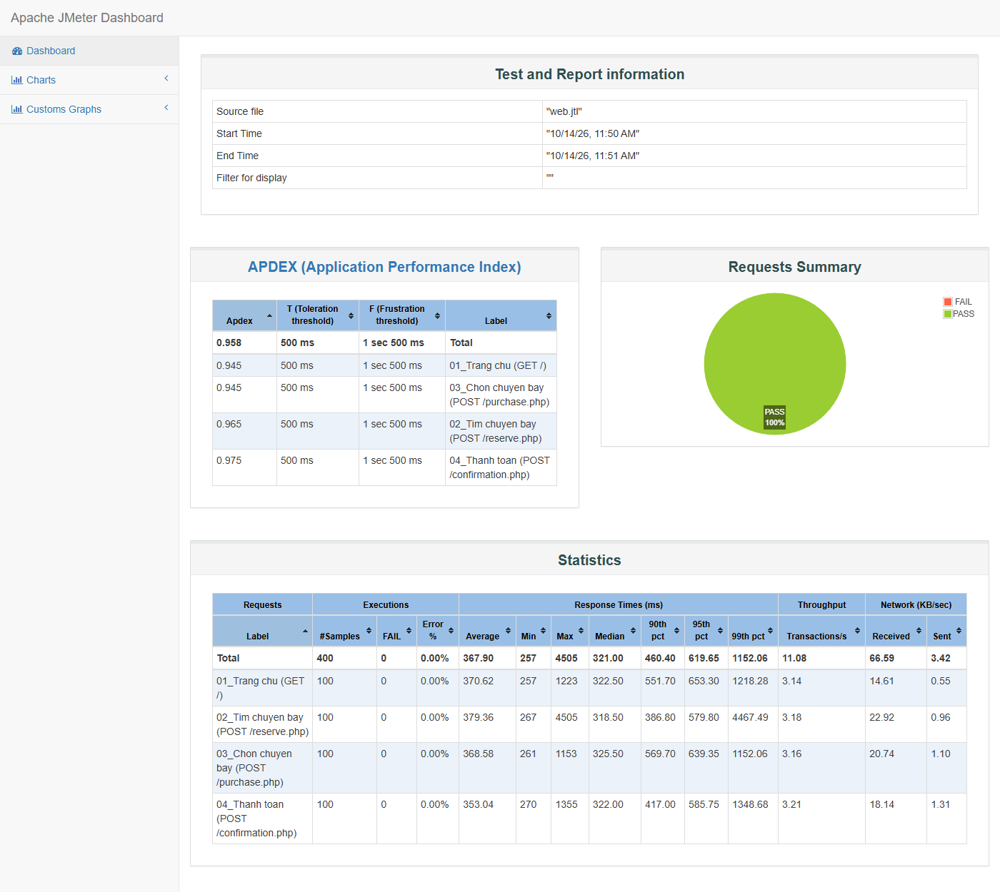
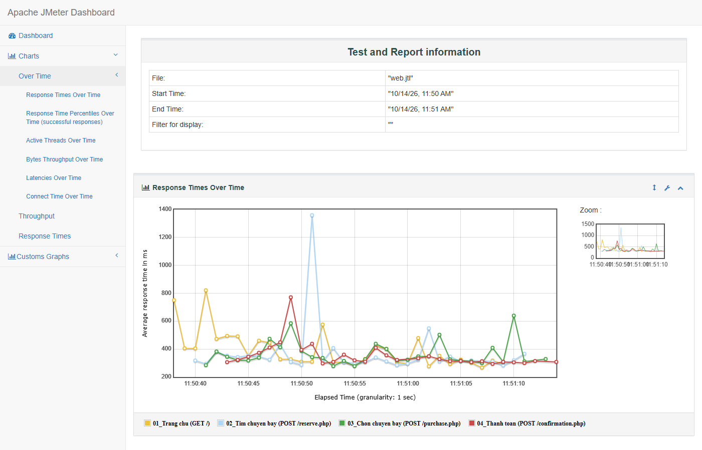
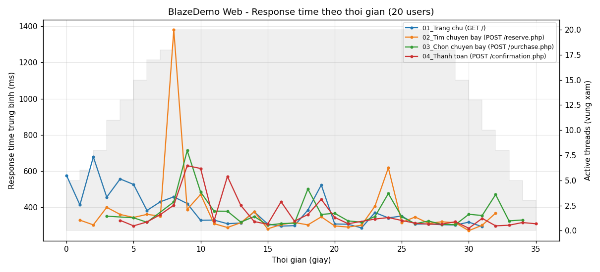
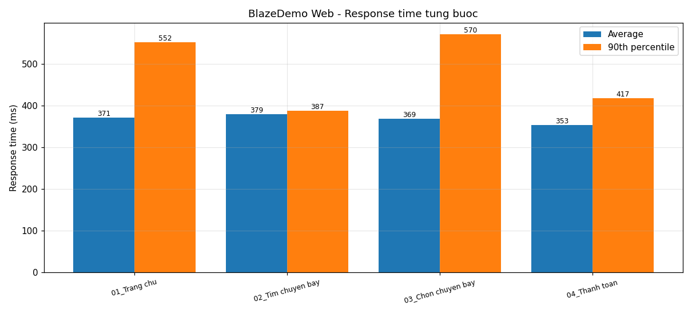
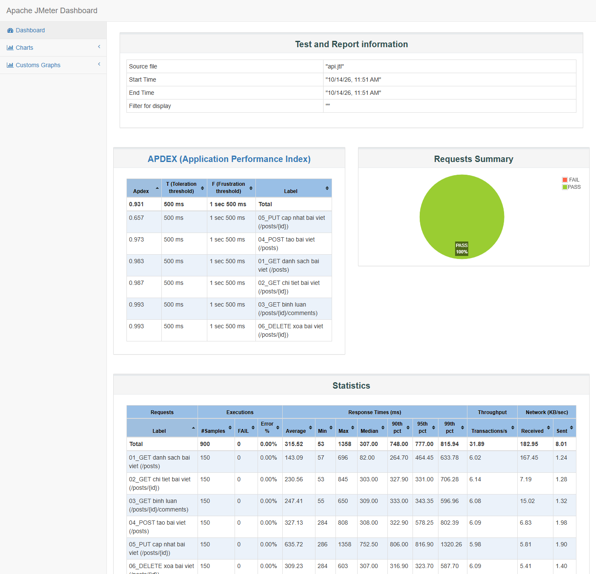
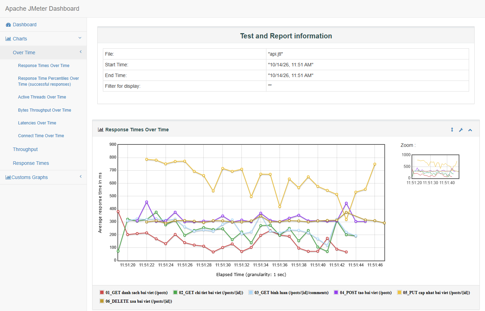
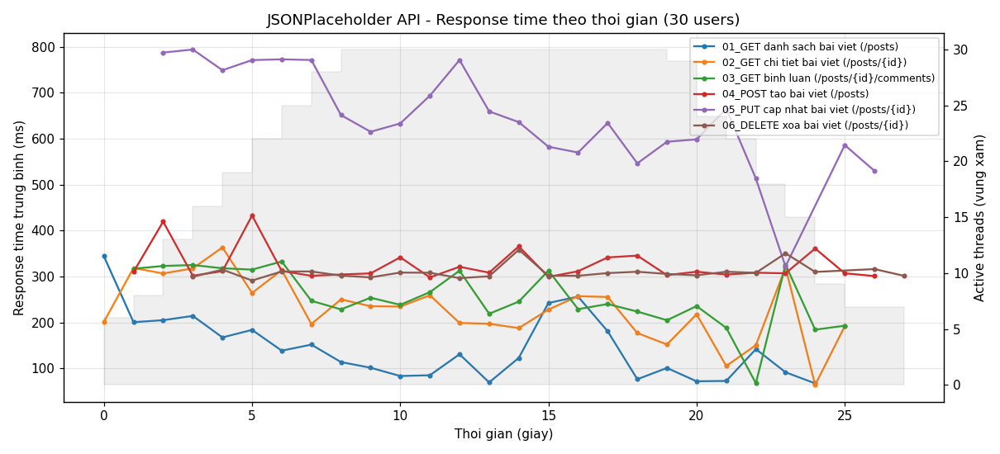
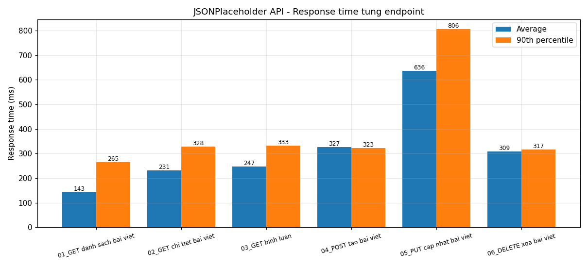
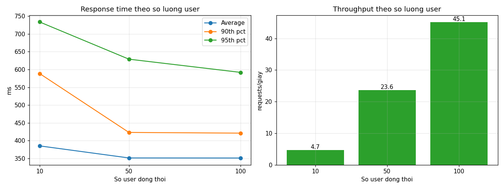
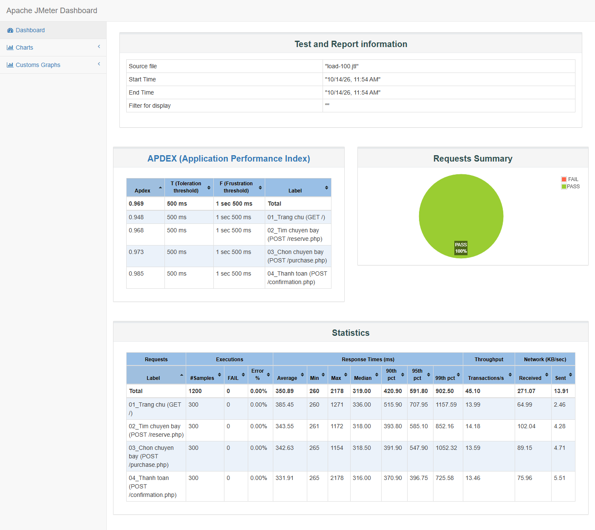

# Kiểm thử hiệu năng với Apache JMeter

Báo cáo bài tập **Học công cụ kiểm thử JMeter**: tìm hiểu JMeter, xây dựng kịch bản kiểm thử hiệu năng cho **một website** và **một REST API**, chạy kiểm thử với các mức tải khác nhau, rồi phân tích kết quả.

| Hạng mục | Thông tin |
|---|---|
| Công cụ | Apache JMeter **5.6.3** (chạy ở chế độ Non-GUI) |
| Môi trường | Windows 11, OpenJDK 17, mạng Internet tại Việt Nam |
| Ngày thực hiện | 14/10/2026 |
| Hệ thống được kiểm thử | [blazedemo.com](https://blazedemo.com) (website demo dành cho việc tập load test) và [jsonplaceholder.typicode.com](https://jsonplaceholder.typicode.com) (REST API giả lập miễn phí) |

> **Lưu ý đạo đức kiểm thử:** cả hai hệ thống trên đều được cung cấp công khai cho mục đích học tập và thử nghiệm. Mức tải được giữ ở mức nhẹ (tối đa 100 user, có think time) để không gây ảnh hưởng tới dịch vụ.

## Mục lục

1. [Tìm hiểu JMeter](#1-tìm-hiểu-jmeter)
2. [Cấu trúc repository](#2-cấu-trúc-repository)
3. [Kịch bản 1 – Kiểm tra hiệu năng website (BlazeDemo)](#3-kịch-bản-1--kiểm-tra-hiệu-năng-website-blazedemo)
4. [Kịch bản 2 – Kiểm tra hiệu năng REST API (JSONPlaceholder)](#4-kịch-bản-2--kiểm-tra-hiệu-năng-rest-api-jsonplaceholder)
5. [Kịch bản 3 – So sánh khi tăng tải (10 / 50 / 100 users)](#5-kịch-bản-3--so-sánh-khi-tăng-tải-10--50--100-users)
6. [Kết luận chung](#6-kết-luận-chung)
7. [Hướng dẫn chạy lại](#7-hướng-dẫn-chạy-lại)
8. [Tài liệu tham khảo](#8-tài-liệu-tham-khảo)

---

## 1. Tìm hiểu JMeter

### 1.1. JMeter là gì?

**Apache JMeter** là công cụ mã nguồn mở viết bằng Java, dùng để kiểm thử tải (load test) và đo hiệu năng của ứng dụng, chủ yếu là ứng dụng web và API. JMeter giả lập nhiều người dùng gửi request đồng thời tới máy chủ, ghi lại thời gian phản hồi, tỉ lệ lỗi và thông lượng. Từ các số liệu này có thể đánh giá hệ thống chịu tải tốt đến đâu.

JMeter hỗ trợ nhiều giao thức: HTTP/HTTPS, REST/SOAP, FTP, JDBC (cơ sở dữ liệu), JMS, LDAP, SMTP, TCP...

### 1.2. Các loại kiểm thử hiệu năng

| Loại | Mục đích |
|---|---|
| **Load test** | Kiểm tra hệ thống dưới mức tải dự kiến |
| **Stress test** | Tăng tải vượt mức bình thường để tìm điểm gãy |
| **Spike test** | Tải tăng đột ngột trong thời gian ngắn |
| **Endurance (Soak) test** | Duy trì tải trong thời gian dài để phát hiện rò rỉ tài nguyên |

### 1.3. Các thành phần chính của một Test Plan

| Thành phần | Vai trò | Ví dụ dùng trong bài |
|---|---|---|
| **Test Plan** | Gốc của kịch bản, chứa biến dùng chung | `HOST`, `THREADS`, `RAMPUP`, `LOOPS` |
| **Thread Group** | Mô phỏng nhóm người dùng: số thread (user), ramp-up, số vòng lặp | 20 users / ramp-up 10 s / 5 vòng |
| **Sampler** | Request gửi tới server | HTTP Request GET/POST/PUT/DELETE |
| **Config Element** | Cấu hình dùng chung | HTTP Request Defaults, Header Manager, Cookie Manager, CSV Data Set Config |
| **Pre/Post Processor** | Xử lý trước/sau request, ví dụ trích xuất dữ liệu từ response (correlation) | Regular Expression Extractor, JSON Extractor |
| **Assertion** | Kiểm tra response có đúng không | Response Assertion, JSON Assertion, Duration Assertion, Size Assertion |
| **Timer** | Thời gian chờ giữa các request (think time) | Uniform Random Timer, Constant Timer |
| **Listener** | Thu thập và hiển thị kết quả | View Results Tree, Summary Report, Aggregate Report |

### 1.4. Các chỉ số quan trọng

- **Samples**: tổng số request đã gửi.
- **Average / Median**: thời gian phản hồi trung bình / trung vị (ms).
- **90th / 95th / 99th percentile**: 90% / 95% / 99% request có thời gian phản hồi nhỏ hơn giá trị này. Chỉ số này phản ánh trải nghiệm người dùng sát hơn so với giá trị trung bình.
- **Error %**: tỉ lệ request lỗi (sai mã HTTP hoặc không qua Assertion).
- **Throughput**: số request server xử lý được mỗi giây (req/s).
- **APDEX**: chỉ số hài lòng của người dùng, từ 0 đến 1. Ngưỡng mặc định: T = 500 ms (hài lòng), F = 1500 ms (khó chịu). Càng gần 1 càng tốt.

### 1.5. Cài đặt

1. Cài Java JDK 8+ (bài này dùng OpenJDK 17). Kiểm tra bằng `java -version`.
2. Tải JMeter tại <https://jmeter.apache.org/download_jmeter.cgi> (bản *Binaries* `.zip`) rồi giải nén.
3. Mở giao diện: chạy `bin\jmeter.bat` (Windows) hoặc `bin/jmeter.sh` (Linux/macOS).
4. Chạy kiểm thử thật: nên dùng **chế độ Non-GUI** vì GUI tiêu tốn nhiều tài nguyên và làm sai lệch kết quả:

```bash
jmeter -n -t <kich_ban>.jmx -l <ket_qua>.jtl -e -o <thu_muc_report>
```

| Tham số | Ý nghĩa |
|---|---|
| `-n` | Non-GUI mode |
| `-t` | File kịch bản `.jmx` |
| `-l` | File ghi kết quả `.jtl` |
| `-e -o` | Sinh HTML Dashboard vào thư mục chỉ định |
| `-Jthreads=50` | Truyền property, được đọc trong kịch bản bằng `${__P(threads,20)}` |

---

## 2. Cấu trúc repository

```
JMeter_kiemDinh/
├── README.md                     # Báo cáo (file này)
├── run_tests.bat                 # Script chạy toàn bộ kịch bản ở Non-GUI mode
├── test-plans/
│   ├── 01_BlazeDemo_Web.jmx      # Kịch bản 1: website đặt vé máy bay
│   └── 02_JSONPlaceholder_API.jmx# Kịch bản 2: REST API CRUD
├── data/
│   └── routes.csv                # Dữ liệu test: các cặp điểm đi/điểm đến
├── results/
│   ├── *.jtl                     # Kết quả thô của từng lần chạy
│   └── *-report/index.html       # HTML Dashboard do JMeter sinh ra
├── scripts/
│   └── make_charts.py            # Vẽ biểu đồ minh hoạ từ file kết quả
└── images/                       # Hình ảnh minh hoạ dùng trong báo cáo
```

---

## 3. Kịch bản 1 – Kiểm tra hiệu năng website (BlazeDemo)

### 3.1. Mục tiêu

- Dùng JMeter mô phỏng người dùng **đặt vé máy bay** trên https://blazedemo.com, trọn luồng từ trang chủ đến thanh toán.
- Đo thời gian phản hồi, tỉ lệ thành công/thất bại và thông lượng của từng bước.
- Đánh giá hiệu năng website dựa trên kết quả.

### 3.2. Kịch bản kiểm tra

**Luồng nghiệp vụ:** Trang chủ → Tìm chuyến bay → Chọn chuyến bay → Thanh toán

```
01 - BlazeDemo Web - Dat ve may bay   (Test Plan: HOST, THREADS, RAMPUP, LOOPS)
├── HTTP Request Defaults             (https://blazedemo.com, timeout 10s/30s)
├── HTTP Header Manager               (User-Agent, Accept-Language)
├── HTTP Cookie Manager               (xoá cookie mỗi vòng lặp)
├── CSV Data Set Config               (data/routes.csv -> ${fromPort}, ${toPort})
├── Thread Group "Nguoi dung dat ve"
│   ├── 01_Trang chu (GET /)
│   │   └── Response Assertion: "Welcome to the Simple Travel Agency!"
│   ├── Uniform Random Timer (0.5 – 1.5 s think time)
│   ├── 02_Tim chuyen bay (POST /reserve.php  fromPort, toPort)
│   │   ├── Regular Expression Extractor -> lấy NGẪU NHIÊN 1 chuyến bay (flight, price, airline)
│   │   └── Response Assertion: "Flights from ${fromPort} to ${toPort}"
│   ├── 03_Chon chuyen bay (POST /purchase.php  ${flight_g1}, ${flight_g2}, ${flight_g3})
│   │   └── Response Assertion: "has been reserved"
│   └── 04_Thanh toan (POST /confirmation.php  thông tin khách hàng + thẻ test)
│       ├── Response Assertion: "Thank you for your purchase today!"
│       └── Duration Assertion: <= 3000 ms
├── View Results Tree
├── Summary Report
└── Aggregate Report
```

**Cấu hình tải:**

| Tham số | Giá trị |
|---|---|
| Số thread (user) | 20 |
| Ramp-up period | 10 giây |
| Số vòng lặp mỗi user | 5 |
| Tổng số request | 20 × 5 × 4 = **400** |
| Think time | 0.5 – 1.5 giây (ngẫu nhiên) |

**Các kỹ thuật JMeter đã áp dụng:**

- **Tham số hoá dữ liệu** bằng *CSV Data Set Config*: mỗi user lấy một cặp thành phố khác nhau trong `data/routes.csv`.
- **Correlation** bằng *Regular Expression Extractor*: lấy thông tin chuyến bay động từ response của bước 2 để gửi cho bước 3, giống thao tác của người dùng thật.
- **Assertion** cho từng bước để xác nhận nghiệp vụ chạy đúng, không chỉ dựa vào mã HTTP 200.
- **Property `${__P(...)}`**: số user/vòng lặp truyền từ dòng lệnh, không phải sửa file `.jmx`.

> Số thẻ `4111111111111111` là số thẻ test công khai, không phải thẻ thật.

### 3.3. Kết quả kiểm tra

**HTML Dashboard (Statistics + APDEX)**



**Response Times Over Time (JMeter Dashboard, granularity 1 giây)**



**Biểu đồ response time theo thời gian, kèm số user đang hoạt động (vùng xám)**



**Response time theo từng bước**



### 3.4. Phân tích kết quả

| Request | Samples | Lỗi | Average (ms) | Median (ms) | 90% (ms) | 95% (ms) | Max (ms) | Throughput (req/s) |
|---|---|---|---|---|---|---|---|---|
| 01_Trang chu | 100 | 0 | 371 | 322 | 552 | 653 | 1223 | 3.14 |
| 02_Tim chuyen bay | 100 | 0 | 379 | 318 | 387 | 580 | 4505 | 3.18 |
| 03_Chon chuyen bay | 100 | 0 | 369 | 326 | 570 | 639 | 1153 | 3.16 |
| 04_Thanh toan | 100 | 0 | 353 | 322 | 417 | 586 | 1355 | 3.21 |
| **Tổng** | **400** | **0** | **368** | **321** | **460** | **620** | **4505** | **11.08** |

- **Số request thành công:** 400/400 = **100%**. Tất cả Assertion đều đạt, kể cả Duration Assertion ≤ 3 s ở bước thanh toán.
- **Số request thất bại:** 0/400 = **0%**.
- **Thời gian phản hồi trung bình:** 368 ms; **trung vị:** 321 ms.
- **Percentile 90:** 460 ms; **percentile 95:** 620 ms.
- **Throughput:** 11.08 request/giây.
- **APDEX:** **0.958**, mức rất tốt.
- Có **1 request đột biến 4505 ms** ở bước *Tìm chuyến bay* tại giây thứ ~9, đúng lúc vừa đủ 20 user (cuối giai đoạn ramp-up). Connect time của request này bằng 0, tức là nó dùng lại kết nối có sẵn, nên độ trễ đến từ phía server/mạng tại thời điểm đó chứ không phải do bắt tay HTTPS. Request này làm Max và percentile 99 của bước 2 cao lên, còn median vẫn ổn định quanh 320 ms.
- Thời gian phản hồi **nhỏ nhất ~257 ms** chủ yếu là độ trễ mạng từ Việt Nam tới server (đặt ở nước ngoài), không phải thời gian xử lý của server.

### 3.5. Kết luận

Website https://blazedemo.com có **hiệu năng tốt** với 20 người dùng đồng thời: **không có lỗi**, 90% request phản hồi dưới **0.5 giây**, APDEX đạt 0.958. Các bước trong luồng đặt vé có thời gian phản hồi tương đương nhau, không có bước nào là nút thắt cổ chai. Điểm cần chú ý là đôi khi có request chậm bất thường lúc bắt đầu tăng tải.

---

## 4. Kịch bản 2 – Kiểm tra hiệu năng REST API (JSONPlaceholder)

### 4.1. Mục tiêu

- Dùng JMeter kiểm tra hiệu năng REST API https://jsonplaceholder.typicode.com với đủ 4 phương thức **GET / POST / PUT / DELETE**.
- Xác thực nội dung JSON trả về, không chỉ kiểm tra mã trạng thái.
- Phân tích thời gian phản hồi của từng endpoint và đưa ra kết luận.

### 4.2. Kịch bản kiểm tra

```
02 - JSONPlaceholder REST API - CRUD
├── HTTP Request Defaults        (https://jsonplaceholder.typicode.com)
├── HTTP Header Manager - JSON   (Content-Type / Accept: application/json)
├── Thread Group "API Clients"
│   ├── Constant Timer 300 ms
│   ├── 01_GET  /posts
│   │   ├── Response Assertion: HTTP 200
│   │   ├── JSON Extractor: $[*].id  -> ${postId} (chọn ngẫu nhiên)
│   │   └── Size Assertion: body > 1 KB
│   ├── 02_GET  /posts/${postId}            -> HTTP 200, JSON Assertion $.id == ${postId}
│   ├── 03_GET  /posts/${postId}/comments   -> HTTP 200, JSON Assertion $[0].postId == ${postId}
│   ├── 04_POST /posts  (body JSON)         -> HTTP 201, JSON Assertion $.id == 101
│   ├── 05_PUT  /posts/${postId} (body JSON)-> HTTP 200, JSON Assertion $.title == "Updated by JMeter"
│   └── 06_DELETE /posts/${postId}          -> HTTP 200
├── View Results Tree
├── Summary Report
└── Aggregate Report
```

Ví dụ body của request **POST** (dùng các hàm có sẵn của JMeter để sinh dữ liệu động):

```json
{
  "title": "JMeter test ${__threadNum}-${__counter(FALSE,)}",
  "body": "Kiem thu hieu nang API bang JMeter",
  "userId": ${__Random(1,10,)}
}
```

**Cấu hình tải:**

| Tham số | Giá trị |
|---|---|
| Số thread (user) | 30 |
| Ramp-up period | 10 giây |
| Số vòng lặp mỗi user | 5 |
| Tổng số request | 30 × 5 × 6 = **900** |
| Think time | 300 ms cố định |

### 4.3. Kết quả kiểm tra

**HTML Dashboard**



**Response Times Over Time (JMeter Dashboard)**



**Biểu đồ response time theo thời gian**



**So sánh response time giữa các endpoint**



### 4.4. Phân tích kết quả

| Endpoint | Samples | Lỗi | Average (ms) | Median (ms) | 90% (ms) | 95% (ms) | Max (ms) | APDEX |
|---|---|---|---|---|---|---|---|---|
| 01_GET /posts | 150 | 0 | 143 | 82 | 265 | 464 | 696 | 0.983 |
| 02_GET /posts/{id} | 150 | 0 | 231 | 303 | 328 | 331 | 845 | 0.987 |
| 03_GET /posts/{id}/comments | 150 | 0 | 247 | 309 | 333 | 343 | 650 | 0.993 |
| 04_POST /posts | 150 | 0 | 327 | 308 | 323 | 578 | 808 | 0.973 |
| 05_PUT /posts/{id} | 150 | 0 | **636** | **752** | **806** | **817** | 1358 | **0.657** |
| 06_DELETE /posts/{id} | 150 | 0 | 309 | 307 | 317 | 324 | 603 | 0.993 |
| **Tổng** | **900** | **0** | **316** | **307** | **748** | **777** | **1358** | **0.931** |

- **Số request thành công:** 900/900 = **100%**, mọi JSON Assertion đều đạt (dữ liệu trả về đúng với `postId` đã trích xuất).
- **Số request thất bại:** 0/900 = **0%**.
- **Thời gian phản hồi trung bình:** 316 ms; **trung vị:** 307 ms; **percentile 90:** 748 ms.
- **Throughput:** **31.89 request/giây**.
- **APDEX tổng:** 0.931.
- **Các request GET nhanh nhất** (nhỏ nhất ~53 ms, `GET /posts` có median chỉ 82 ms) vì được **CDN cache**: header trả về có `cf-cache-status: HIT`, tức là response đến thẳng từ edge server Cloudflare gần người dùng.
- **POST / PUT / DELETE** không được cache (`cf-cache-status: DYNAMIC`) nên luôn phải đi tới server gốc, thời gian nhỏ nhất ≈ 284 ms.
- **`PUT /posts/{id}` chậm nhất**: trung bình 636 ms, median 752 ms, APDEX chỉ 0.657. Mức này chậm gấp đôi POST/DELETE, dù cả ba đều không được cache. Từ phía client không xác định được nguyên nhân cụ thể bên trong server, nhưng đây là endpoint nên được ưu tiên điều tra và tối ưu.

### 4.5. Kết luận

API JSONPlaceholder có **hiệu năng tốt và ổn định** với 30 client đồng thời: **0% lỗi**, throughput ~32 req/s, các thao tác đọc (GET) và DELETE phản hồi dưới 350 ms với 90% request. Thao tác **PUT** là điểm yếu duy nhất (≈ 0.75 – 0.8 s), làm APDEX tổng giảm xuống 0.931 nhưng vẫn ở mức chấp nhận được.

---

## 5. Kịch bản 3 – So sánh khi tăng tải (10 / 50 / 100 users)

### 5.1. Mục tiêu

Chạy lại **Kịch bản 1** với số user tăng dần để quan sát xu hướng thời gian phản hồi và thông lượng khi tải tăng. Kịch bản giữ nguyên, chỉ thay đổi property:

```bash
jmeter -n -t test-plans/01_BlazeDemo_Web.jmx -Jthreads=100 -Jrampup=10 -Jloops=3 -l results/load-100.jtl -e -o results/load-100-report
```

### 5.2. Kết quả

| Users | Samples | Lỗi | Average (ms) | Median (ms) | 90% (ms) | 95% (ms) | 99% (ms) | Max (ms) | Throughput (req/s) | APDEX |
|---|---|---|---|---|---|---|---|---|---|---|
| 10 | 120 | 0% | 385 | 329 | 589 | 734 | 1136 | 1137 | 4.67 | 0.942 |
| 50 | 600 | 0% | 351 | 315 | 423 | 629 | 1082 | 1255 | 23.58 | 0.966 |
| 100 | 1200 | 0% | 351 | 319 | 421 | 592 | 903 | 2178 | **45.10** | 0.969 |



**HTML Dashboard với 100 users:**



### 5.3. Phân tích và kết luận

- **Throughput tăng gần tuyến tính** theo số user: 4.67 → 23.58 → 45.10 req/s. Server xử lý được toàn bộ lượng request tăng thêm.
- **Thời gian phản hồi không tăng** (median giữ quanh 315 – 330 ms; average ~350 – 385 ms). Ở mức 10 user số liệu còn hơi cao do mẫu ít và có ảnh hưởng của lần kết nối đầu tiên.
- **0% lỗi ở mọi mức tải**, APDEX đều > 0.94.
- ⇒ Với tối đa **100 user đồng thời**, BlazeDemo **chưa chạm tới ngưỡng giới hạn**. Muốn tìm điểm gãy (stress test) cần tăng tải lớn hơn nữa và nên chạy từ nhiều máy (distributed testing) vì một máy client cũng có giới hạn.

---

## 6. Kết luận chung

| Kịch bản | Tải | Thành công | Avg (ms) | P90 (ms) | Throughput | APDEX | Đánh giá |
|---|---|---|---|---|---|---|---|
| Website BlazeDemo | 20 users | 100% | 368 | 460 | 11.08 req/s | 0.958 | Tốt |
| REST API JSONPlaceholder | 30 users | 100% | 316 | 748 | 31.89 req/s | 0.931 | Tốt, PUT hơi chậm |
| BlazeDemo tải tăng dần | 10 → 100 users | 100% | 385 → 351 | 589 → 421 | 4.67 → 45.10 req/s | 0.94 → 0.97 | Mở rộng tốt |

**Những điều học được khi thực hành JMeter:**

1. Xây dựng Test Plan đầy đủ thành phần: Thread Group, Sampler, Config Element, Assertion, Timer, Listener.
2. **Tham số hoá** dữ liệu bằng CSV và **correlation** (Regex/JSON Extractor) để mô phỏng người dùng thật, tránh việc mọi user gửi cùng một request.
3. Dùng **Assertion** để xác nhận nghiệp vụ đúng; nếu chỉ dựa vào mã HTTP 200 thì có thể bỏ sót lỗi.
4. Chạy test ở **Non-GUI mode** và dùng **HTML Dashboard** để phân tích. Dùng property `-J` để tái sử dụng một kịch bản cho nhiều mức tải.
5. Đọc **percentile** và **APDEX** thay vì chỉ nhìn giá trị trung bình; phân biệt được độ trễ mạng, hiệu ứng cache CDN và thời gian xử lý thật của server.

**Hạn chế:** kiểm thử chạy từ một máy cá nhân qua Internet nên kết quả chịu ảnh hưởng của độ trễ mạng quốc tế. Mức tải cũng được giới hạn để không ảnh hưởng tới dịch vụ công cộng.

---

## 7. Hướng dẫn chạy lại

Yêu cầu: Java 8+ và Apache JMeter 5.6.3.

```bat
:: Windows - chạy toàn bộ kịch bản và sinh HTML report vào thư mục results/
set JMETER_HOME=C:\path\to\apache-jmeter-5.6.3
run_tests.bat

:: Vẽ lại biểu đồ trong images/ (cần Python + matplotlib)
python scripts\make_charts.py
```

Hoặc chạy riêng từng kịch bản:

```bash
jmeter -n -t test-plans/01_BlazeDemo_Web.jmx -Jthreads=20 -Jrampup=10 -Jloops=5 \
       -l results/web.jtl -e -o results/web-report \
       -Jjmeter.reportgenerator.overall_granularity=1000
```

Mở `results/<ten>-report/index.html` bằng trình duyệt để xem Dashboard. Có thể mở các file `.jmx` bằng JMeter GUI (`File → Open`) để xem/chỉnh sửa kịch bản.

---

## 8. Tài liệu tham khảo

- Apache JMeter – User's Manual: <https://jmeter.apache.org/usermanual/index.html>
- Build a Web Test Plan: <https://jmeter.apache.org/usermanual/build-web-test-plan.html>
- Generating Dashboard Report: <https://jmeter.apache.org/usermanual/generating-dashboard.html>
- Best Practices (Non-GUI mode): <https://jmeter.apache.org/usermanual/best-practices.html>
- Functions and Variables (`__P`, `__Random`, `__threadNum`...): <https://jmeter.apache.org/usermanual/functions.html>
- BlazeMeter – JMeter tutorials: <https://www.blazemeter.com/blog/jmeter-tutorial>
- Repo tham khảo cách trình bày: <https://github.com/quocbinh93/JMeter>
